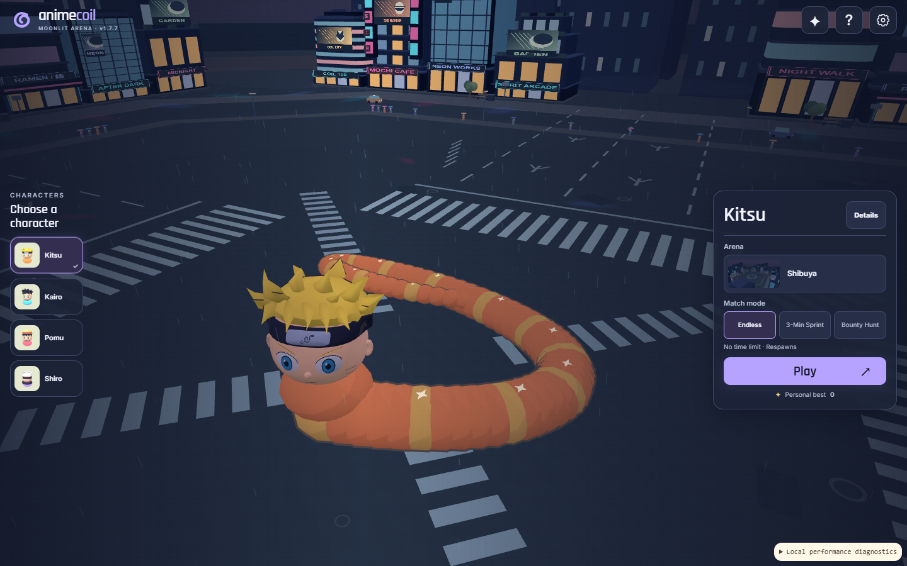
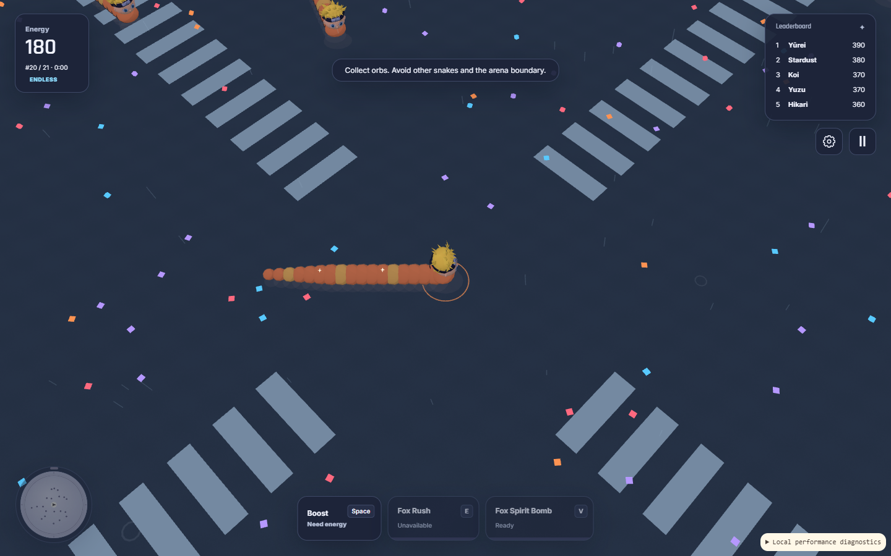

# Anime Coil

A 3D snake-style arena game that runs in the browser: pick a chibi anime-inspired character, grow your coil, and outlast 20 computer-controlled rivals.

**Play it:** _live link coming soon_



## What it is

Anime Coil is a single-player game built with TypeScript and Three.js. You steer a snake through a night-time Shibuya crossing, collect energy orbs to grow, and try not to hit a rival's body or the arena edge. Each of the four characters has its own skill and a cinematic ultimate.

- **4 characters:** Kitsu, Kairo, Pomu and Shiro, each with a different skill and ultimate.
- **20 bots** that hunt orbs, steer around bodies, sometimes try to cut you off, boost, and use their own skills.
- **4 ways to play:** Endless, a 3-minute Sprint, Bounty Hunt, and a guided Practice mode with no opponents.
- **Desktop and touch controls,** with rebindable keys.
- **Saved locally:** best scores, challenge progress, unlockable coil skins and settings stay in your browser. No accounts or server.
- **Comfort settings:** reduced motion and reduced flashes.



## How to play

Collect orbs to grow. Your head touching another snake's body, or the arena edge, ends that life; your own body is safe. A head-on collision takes out both snakes. You respawn after three seconds.

| Action | Desktop | Touch |
| --- | --- | --- |
| Steer | Move the mouse | Drag the left joystick |
| Boost | Hold Space or the left mouse button | Hold BOOST |
| Skill | E or the right mouse button | Tap the skill button |
| Ultimate | V | Tap the V button |
| Pause | Escape | Pause button |

Boosting makes you faster but spends size. Skill and ultimate keys can be changed in Settings.

| Character | Skill |
| --- | --- |
| Kitsu | Fox Rush: free boost for 3 seconds |
| Kairo | Ki Cannon: a short charge, then a shot that knocks rivals back |
| Pomu | Elastic Twist: double turning speed for 3 seconds |
| Shiro | Infinity Veil: slows nearby rivals by 40% for 3 seconds |

**Modes**

- **Endless:** no time limit; chase the highest energy.
- **3-Min Sprint:** biggest energy in three minutes.
- **Bounty Hunt:** three minutes of points for orbs and eliminations, with a marked target worth extra.
- **Practice:** learn steering, boosting and your skill with no opponents.

## Tech stack

- **TypeScript** for all game code
- **Three.js** for 3D rendering, with instanced meshes for bodies and orbs
- **Vite** for the dev server and production build
- **Node test runner + tsx** for tests
- **Blender** for the character heads and city models (exported as GLB)

The game simulation runs at a fixed 60 Hz and is separate from the renderer, so gameplay rules can be tested without a browser. The repo has over 300 automated tests covering movement, collisions, abilities, scoring, game modes and saved progress.

## Run it locally

Needs Node.js 22.12 or newer and npm.

```sh
npm install
npm run dev
```

Open the address Vite prints (usually http://127.0.0.1:5173). Don't open `index.html` directly as a file.

```sh
npm test         # run the test suite
npm run build    # type-check and build for production
npm run preview  # serve the production build locally
```

## Project layout

- `src/simulation.ts`: the game rules: movement, bots, collisions, abilities, modes and scoring
- `src/renderer.ts`: the Three.js scene, camera and instanced rendering
- `src/main.ts` and `src/ui.ts`: menus, HUD, input and settings
- `src/fox.ts`, `src/skybreaker.ts`, `src/spirit.ts`, `src/purple.ts`: the four ultimate cinematics
- `tests/`: automated tests
- `public/`: bundled audio, fonts and 3D models
- `docs/`: release notes and review captures

## Release history

Anime Coil is on version 1.7.8. Every release, with notes and before/after captures, is in [CHANGELOG.md](CHANGELOG.md).

## Credits

Characters, models and names are original, with visual inspiration from popular anime. Voice clip credits are in `public/audio/credits.json`. Fonts are Inter and Rajdhani under the SIL Open Font License (`public/fonts/`).
